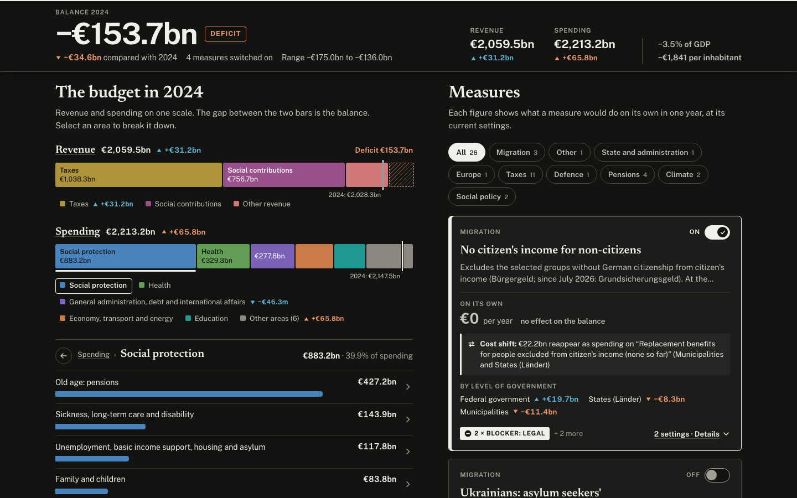
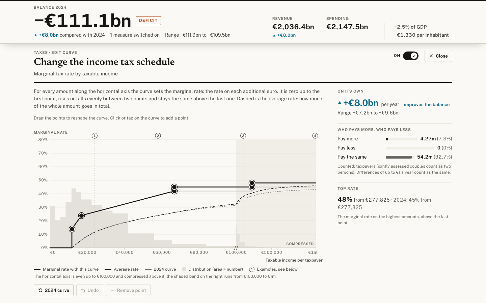

# Budget Simulator

An interactive dashboard of a country's public budget: revenue, spending and balance of the whole state, not only of the central government. You switch on a policy proposal from public debate, such as ending citizen's income for non-citizens, reintroducing the wealth tax or halving MPs' pay, and see at once what it does to the budget and what the catch is: legal limits, costs that move to another level of government, side effects. The site shows numbers and catches and takes no political side.

Germany is the first country. A preview is live at **[budget.drtheile.com](https://budget.drtheile.com)**.



*Germany with four measures switched on (English interface; the site follows the system's light or dark setting). At these settings the first measure relieves the federal government by €19.7bn, while €22.2bn of cost reappears at the states and municipalities.*

## What you can do with it

- Break the budget down from broad areas such as social protection or defence to single items, and see for each item its amount, its sources, its data quality and which level of government bears it.
- Switch measures on and off and move their settings: a tax rate, an allowance, the size of a cut.
- Redraw a rate curve, such as the income tax schedule or the pension contribution rate up to its ceiling: drag the points of the curve on a chart or type them into a table, or start from a preset such as a party's election programme. While you edit, the page shows the effect on the balance, how many taxpayers or employees pay more or less, and what a few example incomes pay under the base year's curve and under the new one.
- See for each measure what it does on its own, the range of the estimate, which levels of government it relieves or burdens, the catches with their severity, and the sources.
- Restrict the whole page to one level of government. For Germany these are the federal government, the states, the municipalities and social insurance.
- See where a scenario leads over the coming decades: how the debt grows and, above all, what share of all revenue goes on interest, with and without the measures. Choose the interest rate on new debt, growth, the number of years and how fast costs such as pensions outgrow the economy, or start from a preset such as "rates as in the United States". The page compares the result with other countries and the EU's 60 % and names the year in which interest would cost more than defence, education and other items.
- Copy a link that reproduces a scenario exactly.



*The curve editor for the German income tax schedule (English interface). In black the edited marginal rate, raised above the grey curve of 2024 in the upper income range; dashed the average rates; behind them the distribution of taxable incomes, with the axis compressed above €100,000. At the side: +€8.0bn a year for the balance (range +€7.2bn to +€9.6bn), 4.27m taxpayers (7.3%) who pay more, and a top rate of 48% from €277,825 instead of 45%.*

## How it works

- **Country packs.** Everything that is specific to a country is data: budget figures, measures, catches, sources and all texts are JSON files in `countries/<id>/`. `countries/de/` is the German pack.
- **Engine.** `src/engine/` is a calculation engine in plain TypeScript, without React, DOM or network access, and it knows nothing about any particular country. It validates a pack, applies the measures that are switched on to the budget, and reports the change for every measure, budget item and level of government, with a low and a high estimate.
- **No server.** The app is a static site built with Vite, React and TypeScript. The packs are part of the build, and all calculation happens in the browser. The app makes no third-party requests (the fonts are bundled) and sets no cookies. The one thing it stores on your device is the interface language, and only if you choose one.
- **Shareable links.** The scenario (which measures are on, their settings including edited curves, the level filter) and the language are kept in the fragment of the URL, for example `https://budget.drtheile.com/#lang=en&s=mp_pay_cut~wealth_tax.rate.15e-1`. While a curve editor is open, the link names it as well (`&e=income_tax_schedule.schedule`), so the link opens the editor. Assumptions of the debt projection that differ from their defaults are in the link too (`&d=r5.1~y40`: 5.1 % on new debt, 40 years). The Share button copies that link. Browsers do not send the fragment to the server, so the host does not learn which scenario you look at.

## How to read the numbers

This describes the German pack. The app has its own version under "About the numbers", which includes the pack's full method note from `countries/de/country.json`.

- **Base year 2024.** It is the latest year for which Eurostat has published government expenditure by function (COFOG). All budget amounts are figures for that one year. Some inputs of measures are older: the distributions of taxable income and of gross wages come from the tax statistics for 2022, with all amounts raised to 2024 levels by the growth of average earnings, and two of the three tax breaks in the transport measure are valued at 2018 figures.
- **The whole state, on a national-accounts basis.** Amounts come from national accounts for general government (federal government, states, municipalities, social insurance), with payments between these levels netted out: revenue of EUR 2,028.3 billion, spending of EUR 2,147.5 billion and a deficit of EUR 119.1 billion, as published in October 2026. They differ from budget plans, because the federal budget is only one part of the state and cash figures follow different definitions.
- **Named items are cash figures.** Individually named items such as citizen's income or MPs' pay are cash figures. The rest of their group is the difference to the national-accounts total of the group and is therefore only approximately right.
- **Levels of government.** Every item is split across the levels that ultimately bear it. Part of that split is published, part is estimated from who is responsible for a task; [pipeline/de/README.md](pipeline/de/README.md) lists what is data and what is judgement. Because payments between levels are netted out, the app shows no balance for a single level, only how far a measure relieves or burdens it.
- **Static estimates for one year.** A measure's figure is its direct effect on the budget of one year, not a forecast over several years. As a rule it is the effect in the first year. One measure is an exception and says so in its summary and its first catch: for the end of the deduction-free early pension, the figure is the annual effect once the rule applies to all cohorts of pensioners, which takes decades. The engine does arithmetic on the base-year amounts: scale an item, add to it, set it, exclude a group of recipients, or apply a tax schedule or rate curve to a distribution of income, wages or wealth. For the income tax and the two contribution curves, today's and the new curve are both applied to the distribution, and the relative change is carried over to the official revenue figure. It does not model the economy. Behavioural reactions appear only where the pack makes them explicit: as a setting (the wealth tax has one for revenue lost to avoidance, the income tax schedule one for revenue lost to behavioural responses), in the range, as a catch, or as the stated assumption of a study that a figure is taken from (the early-pension figure assumes that those affected retire ten months later on average).
- **Three quality labels.** Every budget item and every effect of a measure carries one:

  | Label | Meaning |
  | --- | --- |
  | `official` | Taken directly from official statistics. |
  | `derived` | Calculated from official figures. |
  | `estimate` | Based on assumptions, model calculations or studies. |

  Most German budget items are `derived`: the amount is official or computed from official figures, and its split across the levels of government is computed.
- **Ranges.** Where an effect is uncertain, the pack gives a low and a high multiplier, and the app shows the resulting range next to the central figure. The multipliers are the pack author's judgement, explained in the effect's note and sources. They are not statistical confidence intervals. The range of a scenario is the sum of the low values and the sum of the high values of its measures.
- **Sources.** Every budget item has to name at least one source, or the validator rejects the pack. In the German pack every effect and every catch names one as well. The app lists all sources with publisher, link and date of access; the file is `countries/de/sources.json`.
- **Combinations.** A measure's card shows what it does on its own. In a scenario the measures are applied one after the other in a fixed order, and where two act on the same item, the later one acts on what the earlier one left. Savings are therefore not counted twice, and a measure can have a different effect inside a combination than alone.

## Run it locally

You need Node.js 22.18 or newer and npm.

```sh
git clone https://github.com/andretheile/federal_budget_simulator.git
cd federal_budget_simulator
npm install
npm run dev
```

`npm run dev` starts the Vite dev server and prints the local address (`http://localhost:5173` unless that port is taken).

| Command | What it does |
| --- | --- |
| `npm run dev` | Dev server with hot reload |
| `npm test` | Unit tests (Vitest) |
| `npm run typecheck` | TypeScript checks for the app, the engine and the scripts |
| `npm run validate` | Checks every country pack in `countries/` and prints its totals |
| `npm run build` | Type check, then production build into `dist/` |
| `npm run preview` | Serves the built `dist/` locally |

Python is only needed to rebuild the German budget data ([pipeline/de/README.md](pipeline/de/README.md)). Imprint and privacy statement come from a site config, see [Running your own instance](#running-your-own-instance). Hosting is described in [deploy/README.md](deploy/README.md).

## Project layout

```text
countries/
  de/                      the German country pack
    country.json
    budget.json
    policies.json
    sources.json
    distributions/         taxable_income.json, gross_earnings.json, net_wealth.json
    debt.json              the debt and interest projection
src/
  engine/                  calculation engine, knows no country
    types.ts               the country pack format
    index.ts               public API
    schema.ts, validate.ts checks a pack
    simulate.ts            applies measures to the budget
    distribution.ts        tax schedules over income and wealth distributions
    curve.ts               rate curves: what a unit owes, totals, who pays more or less
    debt.ts                debt and interest over the coming years
    scenario.ts            scenario to URL string and back
    __fixtures__/          Testland, a made-up country for the tests
  app/                     view models and URL state
  components/              React components
  i18n/                    interface texts (German, English) and number formatting
  hooks/, styles/
  site/                    the site config: the operator's details for imprint and privacy statement
  packs.ts                 loads and validates the packs in countries/
  App.tsx, main.tsx
scripts/validate-packs.ts  behind "npm run validate"
pipeline/de/               Python scripts that rebuild the German budget data (own README)
deploy/                    static hosting files and a deploy script (own README)
docs/                      the screenshots in this README
site.config.example.json   example of the site config, with made-up details
```

## Running your own instance

The app is a set of static files and runs on any web server. A site in Germany also needs an imprint (Impressum) and a privacy statement (Datenschutzerklärung). What they say depends on who runs the site and where, so it is not in the source. It comes from a file `site.config.json` in the repository root, which git ignores. [site.config.example.json](site.config.example.json) shows every field with made-up details: copy it and fill in your own. To keep the file somewhere else, set `SITE_CONFIG=/path/to/file.json` for the build.

The build reads the file and checks it. If a field is missing or wrong, the build stops and names every such field. Otherwise it is in one of three states, and it prints which one in a line that starts with `Legal pages:`:

| State | Legal pages | Search engines |
| --- | --- | --- |
| No config | none, and no links to them | asked not to index the site (`noindex`) |
| Config | imprint and privacy statement, linked in the footer | asked not to index the site |
| Config with `"indexable": true` | as above | may index the site |

Both pages are in German and English. They replace the simulator while open and are addressed in the fragment of the URL (`#lang=de&p=imprint`, `&p=privacy`), so they work on any static host; the link back keeps the scenario. The imprint gives the operator's name, address and contact and the person responsible for the content (§ 5 DDG, § 18 Abs. 2 MStV). The privacy statement has two parts. The part about the app describes this code and is written in `src/i18n/legal/`: no cookies, one localStorage entry for a language the visitor chose, no requests to other hosts, all calculation in the browser, the scenario in the fragment of the URL. The part about hosting comes from the config: who hosts and where the server is, what the server logs and for how long, a proxy or CDN in front and the basis for a transfer outside the EU, then the legal basis and the visitors' rights, with the operator as contact.

| Field | Meaning |
| --- | --- |
| `operator` | `name`, `address` (a list of lines), `email` and optionally `phone`. Shown in the imprint and as the controller in the privacy statement |
| `contentResponsible` | Optional `name` and `address` of the person responsible for the content under § 18 Abs. 2 MStV. Default: the operator |
| `hosting` | `name` and `address` of the hoster, `country` of the server as an ISO code such as `DE`, optionally `privacyPolicy` (a URL) |
| `proxy` | Optional proxy or CDN in front of the server, such as Cloudflare: `name`, `address`, the `country` where it processes data, `transfer` for a country outside the EU and the EEA (`dpf` for the EU-US Data Privacy Framework, `adequacy` for an adequacy decision, `scc` for standard contractual clauses), `networkErrorReports: true` if it asks browsers to report failed requests (the `NEL` header), optionally `privacyPolicy` |
| `serverLog` | `fields`, what the access log holds (`time`, `request`, `status`, `bytes`, `referrer`, `userAgent`, `ipAddress`; an empty list for no log), and `retention`: `{ "days": 14 }` or `{ "maxMegabytes": 30 }` |
| `imprint.addition`, `privacy.addition` | Optional paragraphs of your own at the end, per language: `{ "de": "…", "en": "…" }`. A blank line starts a new paragraph |
| `privacy.updated` | Optional date on which the statement was last checked, `YYYY-MM-DD` |
| `indexable` | `true` lets search engines index the site. Default: `false` |

The texts are a starting point, not legal advice: read both pages on your own site and have them checked before you publish. The privacy statement is only true while the server logs what `serverLog` says. [deploy/nginx.conf](deploy/nginx.conf) logs no IP address and no user agent.

## Adding or changing a country

A country pack is a folder `countries/<id>/`, named after the country's lower-case ISO 3166-1 alpha-2 code. The build picks up every folder in `countries/`; nothing has to be registered in code. With more than one pack, the header shows a country switch.

| File | What it holds |
| --- | --- |
| `country.json` | Name, currency, languages, base year, the levels of government that exist and what they are called, reference values (GDP and population, optionally households and gross debt), and a method note that the app shows under "About the numbers" |
| `budget.json` | The budget as two trees, `revenue` and `expenditure` |
| `policies.json` | The measures, in the order in which they are applied |
| `sources.json` | Every source under an id: title, publisher, URL, date of access |
| `distributions/<id>.json` | Optional: distributions that tax measures are calculated from. The German pack has taxable income, gross wages and net wealth |
| `debt.json` | Optional: the projection of debt and interest, with the assumptions a visitor can move, presets, reference values and the budget items that interest is compared with |

The main concepts:

- **Budget tree.** A node is either a group with `children` or a leaf. Only leaves carry an `amount`, in plain currency units per year (euros, not millions); the total of a group is always the sum of its leaves. Node ids are dotted paths that start with `rev.` or `exp.`, such as `exp.social.basic_security.asylum_benefits`.
- **Levels of government.** A country declares which of four levels it has: `central`, `state`, `local` and `social_security`, the subsectors of general government in ESA 2010. Every leaf states which share of its amount each level bears, and the shares sum to 1.
- **Quality and sources.** Every leaf has a `quality` (`official`, `derived` or `estimate`) and at least one source id from `sources.json`.
- **Breakdowns and distributions.** A node can carry a breakdown of its amount into groups, which a measure can then exclude. In the German pack, citizen's income is broken down by the nationality of the recipients. A distribution describes how income or wealth is spread, as bins with an optional Pareto tail, so that a tax schedule or rate curve can be applied to it.
- **Policies.** A measure has `params` (the settings a visitor can move), at least one effect, and `catches`. A param is a `number` (a slider, with an optional `unitLabel` such as "ct/l" that replaces the generic unit on screen), `groups` (a choice of groups of a breakdown) or a `curve` (see below). A number param's `baseline` is its value in the base year; with every number param at its baseline a measure must change nothing, and the validator warns if it does. A number param marked `"role": "assumption"` is not a political choice but an assumption of the calculation, such as how much revenue avoidance costs; the interface marks it as such. An effect names the budget node it changes and has a type: `scale`, `add`, `set`, `excludeGroups` (remove groups of a breakdown) or `schedule` (marginal rates over a distribution, as brackets or as the value of a curve param, calibrated against a `baseline` where one is given). It carries a quality label and, optionally, the low and high multipliers for the range (`uncertainty`). Effects of one measure whose uncertainty names the same `basis` depend on the same uncertain quantity and take the same end of their range together, so that, for example, contributions and the employer's share of them cannot be at opposite ends. Any effect can have a `shift`: a share of its change is passed on to another node, with the opposite sign and its own label, quality, range and note. This is how a cost that moves to another level of government is expressed, and how a knock-on effect is, such as the income tax that falls when employees deduct higher contributions. A catch has a `kind` (`legal`, `economic`, `cost_shift`, `practical` or `political`), a `severity` (`blocker`, `major` or `minor`), a text and its sources.
- **Debt projection (`debt.json`, optional).** A pack can include a projection of debt and interest. `stock` is the general government's gross debt at the end of the base year, and `interest` the interest paid in that year, each with quality and sources. `interest.node` names the budget item that holds interest spending; the projection then starts from that item, so the first year matches the budget exactly. `refinancing.share` is the share of the debt refinanced each year, usually one divided by the average residual maturity. `assumptions` are four number params a visitor can move: `market_rate` (the rate on new and refinanced debt), `growth` (nominal GDP growth), `horizon` (years) and `drift` (a yearly change in the primary balance, in percentage points of GDP, negative for costs that grow faster than the economy, such as ageing). `presets` set some of them at once, for example "rates as in the United States". `references` are values to compare against: other countries, a threshold such as the EU's 60 %, or the country's own past. A reference with `interestRatio` can add `revenueRatio`, the general government's total revenue as a fraction of GDP for the same year and from the same source; the interface then shows that reference's interest as a share of revenue as well, the view it opens with. Leave it out where the source's revenue is not comparable with the country's own. `comparisons` is an optional list of budget items to compare the interest bill with, such as defence and education: each names an `exp.` node other than the interest node, with an optional shorter `label` as it reads after "spending on". The interface says for each item in which year interest overtakes it, or that it does not within the horizon. Like all spending in the projection, the item keeps its base-year share of GDP, as the measures leave it; so the comparison is between interest and that share. The validator checks that each node exists, is spending and is listed once. `note` says in plain words what the projection leaves out. Without `debt.json` a pack simply has no projection.
- **How the projection works.** It is a what-if calculation, not a forecast. GDP grows at the chosen rate. Revenue and spending other than interest keep their base-year share of GDP, plus the drift, so every measure counts in full and for good from the first year. Each year interest is paid on last year's debt: the refinanced share of the debt moves from its old average rate to the market rate, and the rest keeps its rate. The deficit is added to the debt and costs the market rate; a surplus repays debt, and the debt never goes below zero. The range of the measures is carried through as a low and a high path. There is no feedback: higher debt does not raise rates, and measures do not change growth. The projection always covers the whole state, whatever level of government the budget view is filtered to. `npm run validate` prints debt and interest for the base year and 10 and 20 years later, at the default assumptions and without measures.
- **Texts.** Every label and text is an object with one entry per language: `en` is required, plus every locale listed in `country.json`. The interface itself is translated in `src/i18n/`, so far into German and English; for any other locale it falls back to English.

A shortened measure from `countries/de/policies.json`:

```json
{
  "id": "asylum_benefits_cut",
  "label": { "de": "Asylbewerberleistungen kürzen", "en": "Cut asylum seekers' benefits" },
  "summary": {
    "de": "Senkt die Ausgaben nach dem Asylbewerberleistungsgesetz um den eingestellten Anteil.",
    "en": "Reduces spending under the Asylum Seekers' Benefits Act by the chosen share."
  },
  "topic": "migration",
  "params": [
    {
      "id": "cut",
      "type": "number",
      "label": { "de": "Kürzung der Ausgaben", "en": "Cut in spending" },
      "unit": "percent",
      "min": 0,
      "max": 50,
      "step": 5,
      "default": 20,
      "baseline": 0
    }
  ],
  "effects": [
    {
      "type": "scale",
      "target": "exp.social.basic_security.asylum_benefits",
      "factor": { "param": "cut", "scale": -0.01, "offset": 1 },
      "quality": "derived",
      "uncertainty": { "low": 0.5, "high": 1.0 },
      "sources": ["destatis_asylblg_ausgaben"],
      "note": {
        "de": "Kürzung mal Bruttoausgaben 2024 (6,72 Mrd. Euro). Die untere Grenze nimmt an, dass sich nur die Hälfte rechtlich und praktisch umsetzen lässt.",
        "en": "Cut times gross expenditure in 2024 (EUR 6.72 billion). The lower bound assumes that only half can be implemented legally and in practice."
      }
    }
  ],
  "catches": [
    {
      "kind": "legal",
      "severity": "blocker",
      "text": {
        "de": "Das Bundesverfassungsgericht hat 2012 die damaligen Geldleistungen für evident unzureichend erklärt: Die Leistungen müssen das Existenzminimum decken. Pauschale Kürzungen unter dieses Niveau sind unzulässig.",
        "en": "In 2012 the Federal Constitutional Court declared the cash benefits of the time evidently insufficient: benefits must cover the subsistence minimum. Across-the-board cuts below that level are not permitted."
      },
      "sources": ["bverfg_2012_asylblg"]
    }
  ],
  "sources": ["destatis_asylblg_ausgaben", "bverfg_2012_asylblg"]
}
```

A parameter reference evaluates to `value × scale + offset`. At the default cut of 20 %, the `factor` is 0.8, so the item of EUR 6.72 billion falls by EUR 1.34 billion. The `uncertainty` multipliers scale that saving for the low and the high estimate; here the low estimate is half of it.

A `curve` param is an ordered list of points that sets a marginal rate as a function of the distributed variable: zero below the first point, linear between two points, constant above the last, and a step where two points share an `x`. It gives its ranges and grid (`x`, `y`), today's curve, how many points a curve may have, optional `presets` (each with a label, an optional `note` and sources) and `examples` (values for which the editor shows what is owed today and after). A `schedule` effect takes its reform from the param and compares it with fixed `points` as its baseline. Shortened, from the pension contribution measure:

```json
{
  "id": "schedule",
  "type": "curve",
  "label": { "de": "Beitragssatz nach Bruttojahreslohn", "en": "Contribution rate by gross annual wage" },
  "x": { "unit": "currency", "min": 0, "max": 300000, "step": 100 },
  "y": { "unit": "percent", "min": 0, "max": 30, "step": 0.1 },
  "default": [{ "x": 0, "y": 18.6 }, { "x": 90600, "y": 18.6 }, { "x": 90600, "y": 0 }],
  "presets": [
    {
      "id": "no_ceiling",
      "label": { "de": "Beitragsbemessungsgrenze aufheben", "en": "Abolish the contribution ceiling" },
      "points": [{ "x": 0, "y": 18.6 }]
    }
  ],
  "examples": [{ "x": 37500, "label": { "de": "Mittlerer Jahreslohn …", "en": "Median annual wage …" } }]
}
```

The effect that uses it reads `"reform": { "curve": { "param": "schedule", "scale": 0.01 } }`, and its `baseline` is the same three points with `"scale": 0.01`. The default is the base year's curve, so the measure changes nothing until the curve is changed. The validator warns if a curve param's own `baseline` and the effect's `baseline` describe different curves.

To check a pack:

```sh
npm run validate
```

The validator checks the shape of every file (an unknown key is an error), every reference between the files, that shares sum to 1, and that every text exists in every locale. It warns, among other things, if a measure still changes the budget with its params at their base-year values. Each problem is reported with its file and JSON path, and an invalid pack makes the command exit with status 1. For a valid pack it prints the totals and what each measure does on its own at its default settings, so that a reviewer can judge whether the numbers are plausible; for a schedule that is calibrated against a baseline it also prints how close the model comes to the official amount. Shortened:

```text
countries/de: valid
  base year 2024, amounts in EUR per year
    revenue         2,028.34 bn  (46.2 % of GDP)
    expenditure     2,147.49 bn  (49.0 % of GDP)
    balance          -119.15 bn  (-2.7 % of GDP)
  effect on the balance of each policy on its own, at default parameters (low to high):
    asylum_benefits_cut                  +1.34 bn  (+671.85 m to +1.34 bn)
    wealth_tax                          +31.19 bn  (+18.71 bn to +38.98 bn)
    income_tax_schedule                        +0
      model of rev.taxes.income.personal: 409.82 bn against 340.85 bn official (120.2 %)
    defence_spending_target             -65.80 bn  (-72.38 bn to -59.22 bn)

1 pack(s) checked: 1 valid, 0 invalid.
```

The reference for the format is [src/engine/types.ts](src/engine/types.ts). [src/engine/__fixtures__/testland.ts](src/engine/__fixtures__/testland.ts) is a small made-up country that uses every optional field of the format. If a pack does not validate, the app shows Testland in its place, under a notice that lists the errors.

In the German pack, `budget.json` and the three distributions are generated by the scripts in `pipeline/de/`: change the scripts, not the JSON. `country.json`, `policies.json` and `sources.json` are maintained by hand. See [pipeline/de/README.md](pipeline/de/README.md).

## Contributing

To propose a measure or to correct a figure, a catch or a source, open a pull request. If you cannot make the change yourself, open an issue that says which figure or statement is wrong and links the source that shows it.

- **Every number needs a source and a label.** Add the source to `sources.json` and refer to it by its id. Label the figure `official`, `derived` or `estimate`, and give an effect that is not certain a low and a high multiplier.
- **Neutral wording.** The label and the summary of a measure say what it does, not whether it is a good idea. A catch states something that can be checked, such as a court ruling, an article of law or a study, and cites it.
- **All languages.** Texts are needed in English and in every locale of the pack.
- **Check before you open the pull request.** Run `npm run validate`, `npm test` and `npm run typecheck`. Nothing in the repository runs them automatically yet.

## Status and limitations

- **A preview.** The version is 0.1.0, and the pack format is marked "v0" in `src/engine/types.ts` and can still change. Search engines are asked not to index a site unless its site config says `"indexable": true` (see [Running your own instance](#running-your-own-instance)).
- **One country.** Germany, base year 2024, with 26 measures.
- **Static estimates.** The figures are direct effects on the budget of a single year: the first year, except for one measure that shows the annual effect once it is fully phased in. There is no forecast and no model of how the economy reacts.
- **Judgement in the data.** Which level of government bears an item is partly estimated, and the remainders next to named cash items are approximate. [pipeline/de/README.md](pipeline/de/README.md) lists every such judgement.
- **A snapshot.** The German figures are Eurostat's data as of October 2026. Eurostat revises its tables several times a year and the downloaded source files are not in the repository, so a fresh download will usually not reproduce the pack exactly.
- **Two interface languages.** German and English.
- **No automated checks.** Tests, type check and pack validation are run by hand.

## Licence

Apache License 2.0. See [LICENSE](LICENSE).
